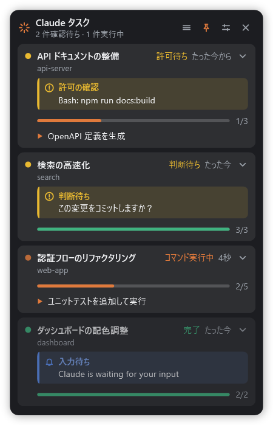
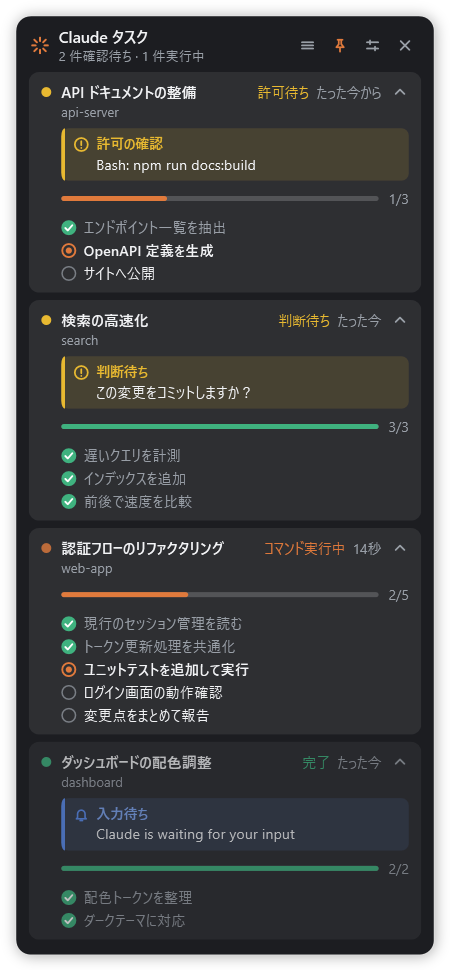
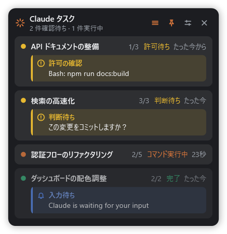

# ClaudeTaskBoard

動作中の Claude Code セッションと、その**タスク一覧・進捗**、Claude Code からの**確認・通知**を、常に最前面のフロートウィンドウに表示する Windows アプリ（WPF / .NET 10）。

> Anthropic の公式ツールではありません。Claude Code の hooks と transcript を読むだけの非公式ツールです。

| 通常表示 | 展開表示 | ミニ表示 |
|---|---|---|
|  |  |  |

（スクリーンショットは架空のデモデータ）

## 表示内容

- セッションごとのカード: タイトル、プロジェクト、状態（思考中 / ツール実行中 / 許可待ち / 完了 / 待機中）、経過時間
- タスクの進捗バー（完了数 / 総数）と、実行中のステップ
- カード右上のシェブロンで全ステップを展開 / 格納（完了 / 実行中 / 未着手のアイコン付き）
- カードのそれ以外の場所をクリックすると、そのセッションのウィンドウを前面に出す
  - デスクトップアプリ: セッションを別ウィンドウで開いていればそのウィンドウ（タイトル一致で判定）を優先し、なければメインウィンドウ。メインウィンドウ内で該当セッションへ切り替える手段は無いため、その場合はトーストで知らせる
  - CLI: セッションのプロセスから親をたどって端末ウィンドウを探す（Windows では記録された pid が既に終了していることが多く、ベストエフォート）
- デスクトップアプリで**別ウィンドウ（子ウィンドウ）に開いているセッションは常に表示**し、タイトル左にウィンドウアイコンを付ける
  - 「完了・待機中を隠す」がオンでも、4 時間以上更新がなくても消えない
  - hook の状態ファイルが無いセッション（hook 導入前から開いている等）も、ウィンドウタイトルと直近 14 日の transcript の `custom-title` を照合して表示する（状態は「待機中」、タスク一覧・判断待ちは transcript から取得）
- 並び順: 確認待ち → 実行中 → 完了・待機。同じグループ内では出現順で固定（カードが飛び回らない）
- 表示切替（カードの出現・退場、展開・格納、ミニ表示、設定パネル、トースト）はフェード + 高さの伸縮でアニメーションする。Windows の「アニメーション効果」がオフなら即時切替

ヘッダーのボタン（左から）: ミニ表示（1行/セッション） / 最前面固定 / 設定 / 閉じる。
ヘッダーをドラッグして移動でき、位置は保存される。設定パネルでは不透明度（スライダー、30〜100%）、完了・待機中セッションの非表示、Windows ログイン時の自動起動を切り替えられる。テーマは Windows のアプリテーマ（ライト/ダーク）に追従する。

### Claude Code からの確認・通知

Claude Code がユーザーに求めている確認や、出している通知をカード内の帯で表示し、ヘッダーに「N 件確認待ち」と出す。新しい確認が来るとボード内のトーストでも知らせる。確認待ちのセッションは一覧の先頭に並び、「完了・待機中を隠す」でも隠れない。

| 表示 | きっかけ | 消えるタイミング |
|---|---|---|
| 許可の確認（何を許可するか: コマンド・ファイル・URL など） | `PermissionRequest` / `Notification`(permission_prompt) | ツールが実行された（PostToolUse）・ターン終了 |
| 質問への回答待ち（質問文） | `AskUserQuestion` の呼び出し | 回答された（PostToolUse） |
| プランの承認待ち | `ExitPlanMode` の呼び出し | 承認・却下された（PostToolUse） |
| 判断待ち（デスクトップアプリのターン末尾の質問） | transcript の `wrap_up` の `ask` | ユーザーが次のプロンプトを送った |
| 入力待ち・その他の通知（青） | `Notification`(idle_prompt ほか) | 次のプロンプト・ツール実行 |

## 前提

- Windows 10 / 11
- Node.js（hook がこれで動く）
- .NET 10 SDK（ビルド用。実行だけなら .NET 10 Desktop Runtime。exe はフレームワーク依存で約 200KB）
- 他のアプリには依存しない。claude-status-tray-windows などの hooks や常駐アプリは不要。

## インストール

```powershell
git clone https://github.com/haruki-sagara/ClaudeTaskBoard.git
cd ClaudeTaskBoard
dotnet publish .\ClaudeTaskBoard.csproj -c Release -p:PublishSingleFile=true -o .\dist
powershell -ExecutionPolicy Bypass -File .\install.ps1
```

1. `dist\ClaudeTaskBoard.exe` を `%LOCALAPPDATA%\ClaudeTaskBoard\` にコピー
2. `hooks\hook.js` を `~/.claude/taskboard/hook.js` にコピーし、`~/.claude/settings.json` に hook を登録（既存の hook は残す。初回のみ `settings.json.bak-taskboard` にバックアップ。再実行しても重複しない）
3. 自動起動が有効なら、その登録先をインストール先の exe に更新
4. デスクトップにショートカット「Claude Task Board」を作成して起動

アンインストールは `.\uninstall.ps1`（自分の hook だけを外し、アプリ・自動起動・インストール先・ショートカットを削除）。

## 安定性・トラブル時の調べ方

- **終了は確認つき**: ✕ と Alt+F4 はボード内で確認してから終了する（Windows のログオフ・シャットダウン時は確認しない）。
- **落ちても戻る**: ボードは 5 秒ごとに `~/.claude/taskboard/board.json` に生存の印を書く。印が 30 秒以上途絶えていれば、次のセッション開始・プロンプト送信時に hook がボードを起動し直す（explorer 経由なので、Claude デスクトップアプリの中ではなく通常のアプリとして起動する）。ユーザーが自分で終了した場合は起動しない（次に手動で起動すると解除）。
- **画面外対策**: スリープ復帰や画面構成の変更で画面外に出たら、画面内に戻す。
- **例外**: UI スレッドの例外は記録して動作を続ける（1 分に 20 回を超えたら終了し、上記の仕組みで再起動）。
- **ログ**: `~/.claude/taskboard/logs/board.log`（1MB で `board.log.1` にローテート）。起動・終了とその理由・例外・スリープ／復帰を記録する。`start` の後に `exit` が無ければ、強制終了またはネイティブクラッシュ（その場合は Windows のイベントビューアー「アプリケーション」も確認）。

## データの取り方

| 情報 | 取得元 |
|---|---|
| セッション・状態・経過時間・確認/通知 | 自前の hook（`hooks\hook.js`）が書く `~/.claude/taskboard/state.d\<session_id>.json`。生存判定は ts が 4 時間以内。24 時間更新のないファイルはボードが削除する（一括削除はしない） |
| タイトル | transcript の `custom-title` 行 |
| タスク一覧 | transcript の `mcp__ccd_turn__update_plan`（全体 / advance / done / start）、`mcp__ccd_turn__wrap_up`（全完了）、CLI の `TodoWrite` |
| 判断待ち | transcript の `mcp__ccd_turn__wrap_up` の `ask`（その後にユーザーのプロンプトが来たら解除） |

環境変数 `TASKBOARD_HOME` を設定すると、hook とボードの両方がその場所を使う（実データに触れずに試すため）。

transcript は前回読んだ位置からの**追記分だけ**を読み、関係する行だけを JSON 解析する（数十 MB の transcript でも初回以外は軽い）。
サブエージェント（`isSidechain: true`）のタスク操作は無視する。

未対応: CLI の新しいタスクツール（`TaskCreate` / `TaskUpdate`）。手元の transcript に実例がなく、入力形式を確認できていないため。

## ビルド・実行

```powershell
dotnet publish .\ClaudeTaskBoard.csproj -c Release -p:PublishSingleFile=true -o .\dist
.\dist\ClaudeTaskBoard.exe
```

二重起動すると既存のウィンドウが前面に出る。

- `ClaudeTaskBoard.exe --selftest` — データ層（タスク再構成・transcript 追記読み）の自己テスト。終了コード 0 で成功。
- `ClaudeTaskBoard.exe --snapshot out.png [--expanded] [--settings] [--dark|--light]` — 実データで画面外に描画して PNG 保存（見た目の確認用）。

設定は `%USERPROFILE%\.claude\taskboard\settings.json`。

## ライセンス・謝辞

[MIT](LICENSE)。

hook の設計（セッションごとの状態ファイル、hook イベントと状態の対応、アトミックな書き込み）は
[claude-status-tray-windows](https://github.com/vyshnav-suresh/claude-status-tray-windows)（MIT。元は
[m1ckc3s/claude-status-bar](https://github.com/m1ckc3s/claude-status-bar)）を参考にしています。ライセンス表記は [LICENSE](LICENSE) に同梱。
